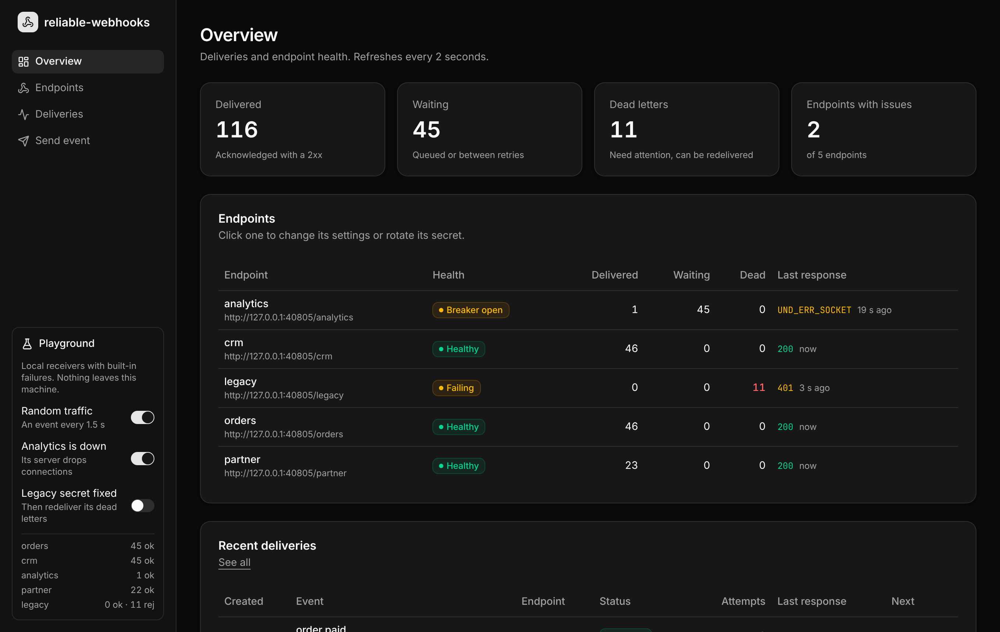

# reliable-webhooks

[](https://github.com/oebh2408/reliable-webhooks/actions/workflows/ci.yml)


Sending a webhook is one HTTP request. Sending it reliably means handling what happens around that request: the endpoint is down for twenty minutes, it rate-limits you, the response is lost after the receiver already processed the message, a secret is misconfigured and every request fails with 401, or the process that was sending crashes halfway.

This library handles both sides. The sender keeps an outbox, retries with backoff, stops hammering endpoints that are down and moves permanent failures to a dead-letter list that can be redelivered. The receiver verifies signatures and runs each message once even when it arrives several times. A dashboard to manage endpoints and inspect deliveries is included. It has no runtime dependencies, works in a long-running worker or in serverless functions, and includes a simulator so it can be tried without any external service.


<sub>Output of the built-in simulator (`npm install && npm run demo`).</sub>

## What it handles

| Situation | Without handling | Handling |
| --- | --- | --- |
| Endpoint returns 5xx or times out | Message lost | Retried with exponential backoff and jitter, 8 attempts over about 11 hours |
| Endpoint rate-limits with 429 | Retries make it worse | `Retry-After` is honoured |
| Endpoint is down for a while | Every queued message keeps failing on its own schedule | Circuit breaker per endpoint: deliveries wait without using up attempts, one probe at a time |
| One endpoint is slow | Every other endpoint waits behind it | Endpoints are sent to in parallel; a slow one only holds up itself |
| Response lost after the receiver processed the message | Sender retries and the receiver processes it twice | Receiver deduplicates by message id |
| Endpoint answers 4xx (wrong secret, bad route) | Retrying for days, or silent loss | Dead letter right away, with the attempt history; redeliver after the fix |
| Endpoint answers 410 Gone | Keeps receiving traffic | Endpoint is disabled |
| Sending process crashes mid-request | Delivery stuck or lost | Lease expires and another worker takes it over |
| Webhook published, then the transaction rolls back | Webhook for something that never happened | `prepare()` lets you write the delivery in the same transaction |
| Forged or replayed request | Receiver acts on it | HMAC signature over id, timestamp and body; timestamps older than 5 minutes rejected |
| Endpoint URL points at an internal address | The sender calls its own network (SSRF) | Private, loopback, link-local and reserved addresses are refused after DNS resolution |
| Endpoint can only take so much traffic | A backlog arrives all at once | `rateLimit` (requests per second) and `maxConcurrency` per endpoint |
| `order.paid` retried and arrives after `order.shipped` | Receiver sees events out of order | Optional ordering key: events with the same key reach each endpoint in publish order |
| Receiver should not hold a key that can sign | A leaked receiver secret lets anyone forge webhooks | ed25519 keys (`v1a`): the receiver only gets the public key |

## Dashboard



To try it with simulated receivers, in a clone of this repository:

```bash
npm install
npm run dashboard        # http://127.0.0.1:4000
```

The playground starts five local receivers with different failures (one drops connections while you switch it off, one answers 503 at random, one is slow, one has a stale secret) and publishes random events. From the sidebar you can take the failing receiver down, fix the stale secret and then redeliver its dead letters from the endpoint page.

What it does:

- Endpoints: add, edit URL and event types, pause and resume, delete. A signing secret is generated for each new endpoint.
- Secrets: reveal and copy, add a new one for rotation (both are used for signing until the old one is removed).
- Health per endpoint: delivered, waiting and dead counts, last response, open circuit breaker, endpoints disabled by a 410.
- Deliveries: filter by status, endpoint or message; open one to see the body and every attempt with status, error and duration.
- Redeliver one dead letter or all of an endpoint's, send a test event to one endpoint, or publish any event.

In your own application, mount it on a port that is not public, with a token:

```ts
import { createServer } from "node:http";
import { createDashboard, WebhookDispatcher } from "reliable-webhooks";
import { PostgresDeliveryStore, PostgresEndpointStore } from "./postgres-store.js";   // see examples/

const endpoints = new PostgresEndpointStore(pool);
const dispatcher = new WebhookDispatcher({ store: new PostgresDeliveryStore(pool), endpoints });

createServer(createDashboard({ dispatcher, endpoints, token: process.env.DASHBOARD_TOKEN })).listen(4000, "127.0.0.1");
```

When the dispatcher gets its endpoints from an `EndpointStore`, it reads them on every publish and tick, so changes made in the dashboard apply to every worker without a restart. The page is a React app built with shadcn/ui and compiled into the package; at runtime it is served by a plain `node:http` handler, so the library still has no dependencies. Design notes and the security model in [ADR 0007](docs/adr/0007-dashboard.md).

## Install

Not on npm yet. Install from GitHub; the package is built on install:

```bash
npm install github:oebh2408/reliable-webhooks
```

Node 18 or later. ESM only.

## Sending

```ts
import { WebhookDispatcher, MemoryDeliveryStore } from "reliable-webhooks";

const dispatcher = new WebhookDispatcher({
  store: new MemoryDeliveryStore(),   // use a database in production, see below
  endpoints: [
    { id: "billing", url: "https://billing.example.com/webhooks", secrets: ["whsec_..."] },
    { id: "crm", url: "https://crm.example.com/hooks", secrets: ["whsec_..."], eventTypes: ["order.paid"] },
  ],
});

dispatcher.onDead((d) => alert(`webhook ${d.id} failed: ${d.deadReason}`));

await dispatcher.publish({ type: "order.paid", payload: { orderId: 42 } });

// publish() only writes to the store. tick() sends what is due:
const stop = dispatcher.start(1_000);   // or call dispatcher.tick() from a scheduler
```

Each endpoint receives a POST with this body and the signature headers:

```http
POST /webhooks HTTP/1.1
content-type: application/json
webhook-id: msg_2b8d6f0c9a1e4d3b5c7a9e1f
webhook-timestamp: 1768208400
webhook-signature: v1,K5oZfzN95Z9UVu1EsfQmfVNQhnkZ2pj9o9NDN/H/pI4=

{"type":"order.paid","timestamp":"2026-01-12T09:00:00.000Z","data":{"orderId":42}}
```

The format follows the [Standard Webhooks](https://www.standardwebhooks.com) specification, so receivers can verify with this library or any compatible one ([ADR 0001](docs/adr/0001-standard-webhooks-signatures.md)).

### Retries and dead letters

| Response | Action |
| --- | --- |
| 2xx | Delivered |
| No response, 408, 425, 429, 5xx | Retry after 5 s, 25 s, 2 min, 10 min, 52 min, 4.3 h, 6 h (each up to 20% shorter, at random) |
| 410 | Dead letter, endpoint disabled |
| Other 4xx, 3xx | Dead letter |

A delivery is also dead-lettered when its attempts run out or it is older than 3 days. Dead letters keep the last 10 attempts with status, error and duration:

```ts
const dead = await dispatcher.deadLetters({ endpointId: "crm" });
// [{ id: "msg_...:crm", deadReason: "rejected", history: [{ status: 401, ... }], ... }]

// After fixing the cause:
await dispatcher.redeliver({ endpointId: "crm" });
```

All values are options (`retry`, `breaker`, `timeoutMs`, `leaseMs`). Why 4xx is not retried: [ADR 0002](docs/adr/0002-retry-policy.md). How the breaker works: [ADR 0004](docs/adr/0004-circuit-breaker-per-endpoint.md).

### Internal addresses and limits

The default transport refuses to connect to private, loopback, link-local and reserved addresses, so an endpoint URL entered by a user cannot reach your internal network or a metadata service. The check runs on the address the connection actually uses, after DNS, so a name that resolves differently later does not get around it. A refused request is dead-lettered with the error `blocked-address`. To send to services on your own network:

```ts
new WebhookDispatcher({ store, endpoints, transport: httpTransport({ allowPrivateNetworks: true }) });
```

Each endpoint can also set how much traffic it takes:

```ts
{ id: "crm", url: "https://crm.example.com/hooks", secrets: ["whsec_..."], rateLimit: 5, maxConcurrency: 2, timeoutMs: 5_000 }
```

`rateLimit` is requests per second; deliveries over it wait without using up attempts. `maxConcurrency` (default 1) is how many requests to that endpoint are in flight at once. Both apply per dispatcher process ([ADR 0008](docs/adr/0008-network-guard-and-endpoint-limits.md)).

### Ordering

Pass an `orderingKey`, usually the id of the entity the event is about:

```ts
await dispatcher.publish({ type: "order.paid", payload, orderingKey: order.id });
await dispatcher.publish({ type: "order.shipped", payload, orderingKey: order.id });
```

For each endpoint, a delivery waits while an earlier one with the same key is pending or being sent, so `order.shipped` is not sent before `order.paid` is delivered, even if `order.paid` needs retries. Events with other keys, or without one, are not held up. If the earlier delivery is dead-lettered, the next one goes ahead; a delivery that waits longer than `maxAgeMs` is dead-lettered as `expired` ([ADR 0009](docs/adr/0009-ordering-keys.md)).

### Metrics and cleanup

Each dispatcher counts attempts by outcome, request durations, deliveries, dead letters by reason and postponements by reason. `dispatcher.metrics.snapshot()` returns them per endpoint; `await dispatcher.prometheus()` returns the Prometheus text format, with queue sizes and breaker state read from the store. The dashboard serves the same text at `api/metrics`, behind its token.

Finished rows stay in the store until they are purged:

```ts
const DAY = 86_400_000;
new WebhookDispatcher({ store, endpoints, retention: { deliveredMs: 7 * DAY, deadMs: 30 * DAY } });
// start() then purges every 10 minutes. Or call it from your own job:
await dispatcher.purge({ deliveredMs: 7 * DAY, deadMs: 30 * DAY });
```

Pending deliveries are never purged.

## Receiving

```ts
import { createServer } from "node:http";
import { WebhookReceiver, nodeHandler } from "reliable-webhooks";

const receiver = new WebhookReceiver({ secrets: [process.env.WEBHOOK_SECRET] });

createServer(
  nodeHandler(receiver, async (event) => {
    // Runs once per message id, even if the sender delivers it several times.
    // Throwing answers 500 and the sender retries.
    if (event.type === "order.paid") await markPaid(event.data);
  }),
).listen(3000);
```

The signature covers the raw body, so the handler must run before any JSON body parser. For other frameworks, call `receiver.handle({ headers, body }, handler)` and answer with the returned `status`.

| Answer | When |
| --- | --- |
| 200 | Processed, or already processed before |
| 401 | Bad signature, or timestamp more than 5 minutes off |
| 400 | Signed, but not a webhook payload |
| 503 + `Retry-After` | The same message is being processed by another request right now |
| 500 | The handler threw; the claim is released so the retry runs it again |

Processed ids are kept for 4 days by default, longer than the sender's retry window. The default `MemoryIdempotencyStore` is per process; with more than one instance, use a shared one such as the PostgreSQL example. Details in [ADR 0003](docs/adr/0003-at-least-once-and-idempotent-receivers.md).

To verify without the idempotency layer, `verifyWebhook({ headers, body, secrets })` returns the id and timestamp or throws `WebhookVerificationError` with a `reason`.

### ed25519 keys

With an HMAC secret, the receiver holds the same secret that signs, so a leak on the receiver's side lets anyone forge webhooks. With an ed25519 key pair the sender keeps the secret key and the receiver gets only the public key. Both kinds can be on one endpoint, which is how you migrate.

```ts
const { secretKey, publicKey } = generateKeyPair();   // whsk_... and whpk_...

// Sender: the secret key goes in the endpoint's secrets and signs as v1a.
{ id: "crm", url, secrets: [secretKey] }

// Receiver: the public key goes in its secrets.
new WebhookReceiver({ secrets: [publicKey] });
```

Keys are serialized as `whsk_`/`whpk_` plus the base64 raw 32-byte key, as the Standard Webhooks specification suggests ([ADR 0010](docs/adr/0010-ed25519-signatures.md)). In the dashboard, "Add ed25519 key" adds one and shows the public key to copy.

## Running with a database

In production the store should be a database shared by every process that publishes or sends. A store implements eight methods, the important one being a conditional update on a version number, plus `head()` for ordering keys and `purge()` for cleanup if you use them. Any database with a conditional write works.

[examples/postgres-store.ts](examples/postgres-store.ts) has a PostgreSQL implementation of the three stores (deliveries, endpoints and received ids). Its tests run the full simulator against a real PostgreSQL engine compiled to WebAssembly (PGlite).

```
API / functions ── publish() ──►  webhook_deliveries  ◄── tick() ── worker or scheduled function ──► endpoints
                                  (status, next_attempt_at, version)
```

- Several dispatchers can share the store. Before sending, a worker takes a lease on the delivery with a conditional update; only one can win it.
- If a worker dies mid-request, the lease expires (`leaseMs`, 60 s) and another worker sends the delivery again. The receiver absorbs the duplicate.
- To make the webhook part of your own transaction, build the deliveries with `prepare()` and insert them with the transaction's client. If the transaction rolls back, nothing is sent. See [examples/outbox.ts](examples/outbox.ts).

```ts
await client.query("BEGIN");
await client.query("UPDATE orders SET status = 'paid' WHERE id = $1", [orderId]);
await new PostgresDeliveryStore(client).insert(
  await dispatcher.prepare({ type: "order.paid", payload: { orderId }, id: `order-paid-${orderId}` }),
);
await client.query("COMMIT");
```

Serverless handlers are in [examples/serverless.ts](examples/serverless.ts). Design notes in [ADR 0005](docs/adr/0005-outbox-store-with-leases.md).

## Try it without external services

`runScenario()` publishes messages to five simulated endpoints, each with a real `WebhookReceiver` behind it:

| Endpoint | Behaviour |
| --- | --- |
| orders | Healthy, but 5% of responses are lost after the message was processed |
| crm | 25% of requests fail with 503 |
| analytics | Down (connection refused) for 20 minutes |
| partner | Rate limited to 4 requests per 10 seconds, answers 429 with `Retry-After` |
| legacy | Its receiver has the wrong secret, so every request gets 401 |

It drives the dispatcher on a simulated clock until every delivery is delivered or dead, then fixes the legacy receiver's secret, redelivers its dead letters and runs again. At the end it checks that every message was handled exactly once by every subscribed endpoint.

```bash
npm run demo -- --messages 500 --seed 3 --workers 4
npm run demo -- --json > run.json
```

With the circuit breaker on, the analytics endpoint receives 10 requests during its outage. With `breaker: false` it receives 390.

## Not handled

- Ordering without an `orderingKey`. Without a key, a retried message can arrive after newer ones.
- Payload size limits.
- Rate limits shared between processes. `rateLimit` is enforced per dispatcher; with several, divide it between them.
- Users, roles and an audit log in the dashboard. It has one shared token; put it behind your own authentication if you need more.

## API

| Member | Description |
| --- | --- |
| `new WebhookDispatcher(options)` | `store`, `endpoints` (array or `EndpointStore`), `transport`, `retry`, `breaker`, `timeoutMs`, `leaseMs`, `historyLimit`, `retention`, `random`, `newId` |
| `publish(event, now?)` | Stores one delivery per subscribed endpoint (or per `event.endpointIds`); idempotent on `event.id` |
| `prepare(event, now?)` | Builds the deliveries without storing them |
| `tick(now?, limit?)` | Sends what is due; returns counts of attempted, delivered, retried, dead, postponed |
| `start(intervalMs?)` | Calls `tick()` on a timer; returns a stop function |
| `deadLetters(query?)` / `redeliver(query?, now?)` | List and requeue dead deliveries |
| `enableEndpoint(id)` | Re-enables an endpoint disabled by a 410 |
| `setEndpoints(endpoints)` / `listEndpoints()` | Replaces / reads the endpoints (an array or an `EndpointStore`) |
| `onAttempt(listener)` / `onDead(listener)` | Called after each attempt / each dead letter |
| `purge(retention, now?)` | Deletes finished deliveries older than `deliveredMs` / `deadMs` |
| `metrics.snapshot()` / `prometheus()` | Counters per endpoint / the Prometheus text format |
| `new WebhookReceiver(options)` | `secrets`, `toleranceMs`, `store`, `leaseMs`, `retainMs` |
| `handle({ headers, body }, handler, now?)` | Verifies, deduplicates, runs the handler; returns `{ status, outcome }` |
| `nodeHandler(receiver, handler)` | `node:http` / Express handler |
| `signWebhook` / `verifyWebhook` / `generateSecret` | Signatures |
| `generateKeyPair()` / `publicKeyFor(secretKey)` | ed25519 keys |
| `MemoryDeliveryStore` / `MemoryEndpointStore` / `MemoryIdempotencyStore` | Reference stores |
| `createDashboard({ dispatcher, endpoints, token? })` | `node:http` handler for the dashboard page and its API |
| `startPlayground(options?)` | The dashboard with simulated receivers, as in `npm run dashboard` |
| `httpTransport({ allowPrivateNetworks?, tls? })` | The default transport, on `node:http`; refuses private addresses unless allowed |
| `fetchTransport()` | A transport on global `fetch`, for runtimes without `node:http`; does not check addresses |
| `isPrivateAddress(ip)` | The address check used by `httpTransport` |
| `runScenario(options?)` | The simulator |

## Design decisions

- [0001 · Signatures in the Standard Webhooks format](docs/adr/0001-standard-webhooks-signatures.md)
- [0002 · What is retried, and how often](docs/adr/0002-retry-policy.md)
- [0003 · At-least-once delivery, idempotent receivers](docs/adr/0003-at-least-once-and-idempotent-receivers.md)
- [0004 · A circuit breaker per endpoint](docs/adr/0004-circuit-breaker-per-endpoint.md)
- [0005 · The outbox: a store with leases and conditional updates](docs/adr/0005-outbox-store-with-leases.md)
- [0006 · An explicit clock](docs/adr/0006-explicit-clock.md)
- [0007 · A dashboard served by the library](docs/adr/0007-dashboard.md)
- [0008 · Private addresses, rate limits and concurrency per endpoint](docs/adr/0008-network-guard-and-endpoint-limits.md)
- [0009 · Ordering keys](docs/adr/0009-ordering-keys.md)
- [0010 · ed25519 signatures](docs/adr/0010-ed25519-signatures.md)

## Development

```bash
npm install
npm test           # unit tests, real HTTP, PostgreSQL (PGlite) and the simulator's exactly-once check
npm run demo
npm run demo:svg       # re-renders docs/demo.svg from the real demo output
npm run dashboard      # builds and starts the playground on :4000
npm run dev:dashboard  # Vite dev server for the page, with the API proxied to :4000
```

## License

MIT © [Oscar Benavides](https://ob0.dev)
